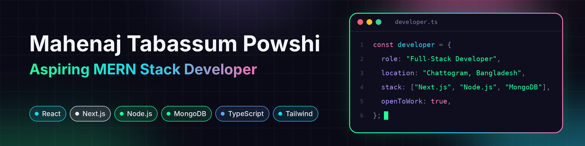

 

  

<h1 align="center">Hi 👋, I'm Mahenaj Tabassum Powshi</h1>

<h3 align="center">Junior Full-Stack Developer 🇧🇩</h3>

  Building responsive web applications and reliable backend solutions.

  📍 Chattogram, Bangladesh &nbsp; | &nbsp;
  📧 <a href="mailto:mahenaj.dev@gmail.com">mahenaj.dev@gmail.com</a>

  <a href="https://mahenaj-tabassum.vercel.app/">Portfolio</a> •
  <a href="https://linkedin.com/in/mahenaj-tabassum">LinkedIn</a> •
  <a href="https://github.com/mahenaj-tabassum">GitHub</a>

---

## 👩‍💻 About Me

I'm a Junior Full-Stack Developer from Chattogram, Bangladesh.

I enjoy building web applications and turning ideas into practical solutions. I'm interested in writing maintainable code, solving problems, and continuously improving my engineering skills.

- 🎓 Enrolled in the **AI-Driven Full Stack Web Engineering** program by Programming Hero.
- 🌱 Currently strengthening my skills in TypeScript, Next.js, and backend development.
- 💻 Building full-stack applications with React, Next.js, Node.js, and Express.js.
- 🔐 Exploring authentication, authorization, and API security.
- 🤖 Exploring AI-assisted development and modern engineering workflows.
- 🎨 Interested in UI design and creating intuitive user experiences.

---

## 🧰 Technical Skills

### Programming Languages

  

### Frontend Development

  

### Backend Development

  

### Database

  

### Tools & Development Environment

  

### Authentication

  
  

---

## 🚀 Featured Projects

### 1. HandsTogether

**Social Development Events Platform**

A full-stack platform for discovering, creating, and joining community events such as tree plantations, food donations, and cleanups.

- Developed REST APIs for event management and filtering.
- Implemented JWT-protected routes and server-side ownership checks.
- Added event joining with duplicate prevention and capacity validation.

**Tech Stack:** Next.js, TypeScript, Tailwind CSS, Node.js, Express.js, MongoDB, Better Auth.

  

### 2. Wanderlust

**Travel Booking Platform**

A travel booking application where users can explore destinations, manage reservations, and organize their trips.

- Developed destination browsing, search, and filtering.
- Implemented booking management and cancellation.
- Integrated email/password and social authentication.

**Tech Stack:** Next.js, React, TypeScript, Tailwind CSS, Node.js, Express.js, MongoDB, Better Auth.

  

### 3. The Daily Brief

**BBC Bangla News Portal**

A responsive news platform that organizes BBC Bangla news articles into categories and provides an accessible reading experience.

- Developed dynamic category pages and article details.
- Integrated the BBC Bangla News API.
- Implemented email/password and Google/GitHub authentication.

**Tech Stack:** Next.js, TypeScript, Tailwind CSS, Better Auth, BBC Bangla News API.

  

---

## 🤝 Connect With Me

  
  
  

---

  <i>Learn continuously. Build thoughtfully. Grow every day.</i>

